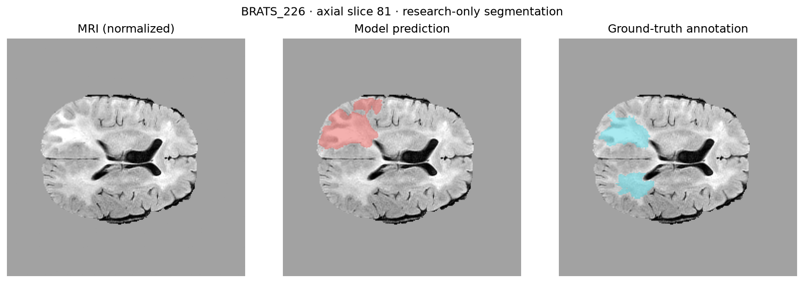
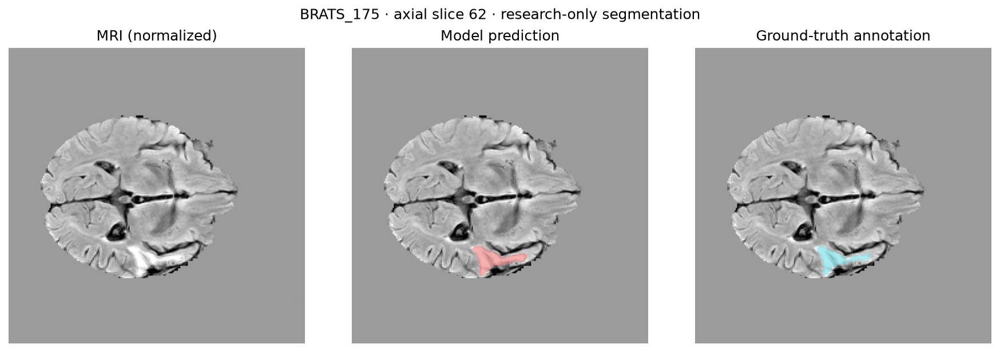
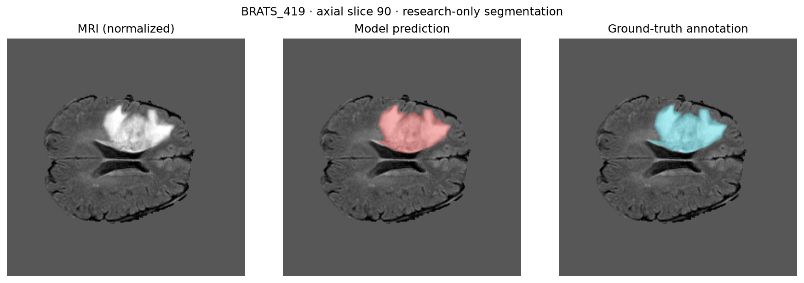
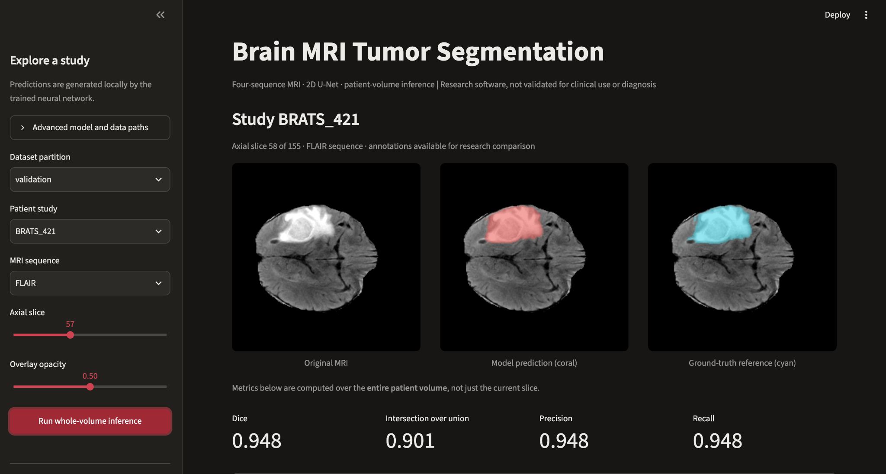

# Brain MRI Tumor Segmentation

**End-to-end, four-modality brain MRI segmentation with a custom PyTorch 2D U-Net.**

This research application reads NIfTI MRI volumes, trains a lightweight neural network to predict the **whole-tumor-associated region** (including edema), and visualizes model predictions alongside reference annotations in an interactive Streamlit viewer. Training, patient-level evaluation, checkpoint management, and inference are implemented locally; no hosted inference API is used.

> **Research and educational software only.** This is **not** a medical device or a method for diagnosing whether a person has a brain tumor. The dataset consists of glioma cases; no healthy-versus-tumor screening, external-site evaluation, or clinical validation was performed.

## Measured results

The baseline model was trained on the labeled portion of the Medical Segmentation Decathlon **Task01_BrainTumour** dataset using a fixed patient-level split (338 train / 73 validation / 73 internally held-out test). The checkpoint was selected at epoch 24 of a 30-epoch training run based on validation mean Dice. The prediction threshold was fixed at **0.50** after a validation-only threshold sweep.

| Patient-macro metric | Validation (73) | Internally held-out test (73) |
|---|---:|---:|
| Dice similarity | 0.8740 | **0.8856** |
| Intersection over union | 0.7890 | **0.8014** |
| Precision | 0.8863 | **0.8817** |
| Recall | 0.8800 | **0.8980** |

These results measure agreement with **binary voxel annotations over complete MRI volumes**, not diagnostic accuracy. They use an **internal split of the labeled MSD cases**, not the official unlabeled challenge test set. The model processes 2D slices independently, then aggregates the resulting predictions for volume-level evaluation. See [`docs/FINAL_EVALUATION.md`](docs/FINAL_EVALUATION.md), [`docs/MODEL_CARD.md`](docs/MODEL_CARD.md), and [`results/benchmark_summary.json`](results/benchmark_summary.json).

## Download the trained model

The trained PyTorch 2D U-Net checkpoint is available through
[GitHub Releases](https://github.com/Dold18/brain-mri-tumor-segmentation/releases/tag/v1.0.0).

- **Checkpoint:** `best.pt`
- **Selected epoch:** 24
- **Decision threshold:** 0.50
- **Held-out test Dice:** 0.8856

The checkpoint requires the inference and preprocessing code
included in this repository.

For research and educational use only. Not clinically validated.


## Actual held-out examples

The following figures were generated by the trained epoch-24 checkpoint from held-out MRI data. Color panels indicate **coral = model prediction** and **cyan = dataset annotation**. Scores are for the *entire patient volume*, not just the displayed slice.

| Lower-performing case | Mid-range case | Strong-performing case |
|---|---|---|
|  |  |  |
| BRATS_226 · Dice **0.6061** | BRATS_175 · Dice **0.8002** | BRATS_419 · Dice **0.9611** |

The figures are adaptations of MSD brain MRI data with additional overlays and labels; see [`docs/DATA_AND_ASSET_ATTRIBUTION.md`](docs/DATA_AND_ASSET_ATTRIBUTION.md) for licensing and citations.

## Interactive application



*Screenshot from the working Streamlit viewer on the development Mac: **validation** study BRATS_421, FLAIR axial slice, using real epoch-24 model inference. Displayed Dice (0.948) is **patient-volume validation performance**, not a separate held-out test benchmark. The sidebar provides slice/modality selection; additional error maps are available in the viewer below the screenshot crop.*

## How the system works

```text
MSD multimodal NIfTI volumes + segmentation labels
        │
        ├── Validate patient IDs, channel order, voxel shapes and labels
        ├── Patient-level immutable 338/73/73 split manifest
        └── Per-patient, per-modality foreground normalization
                     ↓
       Memory-mapped [Z, 4, H, W] slice cache
                     ↓
       2D U-Net (encoder / skip connections / decoder)
                     ↓
        Dice + BCE loss, AdamW, balanced slice sampler
                     ↓
         Checkpoint selected by validation Dice
                     ↓
         Full-volume probability masks (0.50 threshold)
                     ├── Patient-level Dice, IoU, precision, recall
                     ├── CSV / JSON reports and comparison figures
                     └── Streamlit slice viewer + error overlays
```

**Implementation highlights**

- Four-channel input with a custom GroupNorm/ReLU 2D U-Net (`brain_mri/model.py`), configured with 16 base channels.
- NIfTI loading, orientation and alignment checks, binary mask construction, and percentile-clipped per-volume intensity normalization.
- Read-only, memory-mapped slice caches; balanced positive/negative slice sampling and synchronized spatial flips.
- Deterministic partition manifest stored and fingerprinted in checkpoints. All test cases remain outside training and checkpoint selection.
- Atomic checkpoint saving, safe checkpoint loading, interrupted-run resumption, per-patient validation, and an explicit held-out evaluation guard.
- Interactive Streamlit slice browsing with real checkpoint-backed predictions, ground-truth comparison, disagreement map, and downloadable comparison image.

The architecture does **not** use 3D convolutions or encode context between neighboring slices. The binary label merges all non-background annotation classes, including edema; it does not classify tumor type, grade, or healthy-versus-diseased status.

## Reproduce the software

Use **Python 3.11**. On the development macOS system the default data root is `/Volumes/Storage/brain-mri-tumor-segmentation`. On another machine, set `BRAIN_MRI_STORAGE_ROOT` to a writable location **before** running Python; no source edits are required. For example: `export BRAIN_MRI_STORAGE_ROOT="$HOME/brain-mri-data"`. See [`docs/PORTABLE_SETUP.md`](docs/PORTABLE_SETUP.md).

```bash
python3.11 -m venv .venv
source .venv/bin/activate
python -m pip install --upgrade pip setuptools wheel
python -m pip install -e '.[dev,app]'
python -m pytest -q
python -m scripts.smoke_test
```

These automated checks use synthetic fixtures, not the private local cache or claimed performance figures. A real-data reproduction needs the approximately 7 GB source archive **plus substantial space for extraction and the derived cache**.

```bash
# Download the official MSD Task01_BrainTumour archive to the configured data root.
python -m scripts.fetch_msd
python -m scripts.inspect_dataset --limit 3
python -m scripts.prepare_splits       # never regenerate an existing manifest to tune outcomes
python -m scripts.prepare_cache --config configs/baseline.yaml
python -m brain_mri.train --config configs/baseline.yaml --device auto
```

To open the viewer after a trained checkpoint exists:

```bash
streamlit run app/streamlit_app.py
```

For validation or a **new independent held-out evaluation in a fresh replication**, use `python -m brain_mri.evaluate --help`. That command requires explicit `--confirm-heldout` for the test partition. The reported held-out results above should be treated as a completed, frozen evaluation—not an invitation to tune against the test cases. More detailed instructions are in [`docs/STORAGE_SETUP.md`](docs/STORAGE_SETUP.md), [`docs/REAL_DATA_RUN.md`](docs/REAL_DATA_RUN.md), and [`docs/DEVELOPER_SETUP.md`](docs/DEVELOPER_SETUP.md).

## Repository guide

| Path | Purpose |
|---|---|
| `brain_mri/` | Core data loading, U-Net, training, metrics, evaluation, inference |
| `configs/` | Baseline and exploratory experiment YAML |
| `scripts/` | Dataset integrity, caching, experiments, evaluation plots, audit |
| `app/streamlit_app.py` | Interactive MRI viewer |
| `tests/` | Synthetic fixtures and reproducibility checks |
| `results/` | Frozen run summary, per-case held-out scores, audit fingerprint |
| `figures/` | Actual held-out examples derived from the dataset |
| `docs/` | Method, model card, evaluation, release audit and attribution |

The original MRI dataset, large caches, checkpoint weights and training run directories are intentionally **not tracked in Git**. The checkpoint used for the reported experiment is identified by SHA-256:

```text
de19d735e98f610856151fe08ef8669f083649e100cce771be3c01d70ad8cf44
```

The fingerprint verifies identity, **not** model safety. Public model-weight distribution is configured (see best.pt); other users can train from source. The release audit passed on the original Mac and checked local files, split integrity, and agreement between the patient-level and aggregate reports, without recomputing the neural network predictions.

## Dataset citation, licensing, and limitations

Data: **Medical Segmentation Decathlon**, `Task01_BrainTumour`, sourced via [official data download](https://medicaldecathlon.com/dataaws/) / [AWS Open Data](https://registry.opendata.aws/msd/), licensed **CC BY-SA 4.0**. Cite Antonelli et al., *The Medical Segmentation Decathlon*, *Nature Communications* (2022), DOI: [10.1038/s41467-022-30695-9](https://doi.org/10.1038/s41467-022-30695-9); see [`docs/DATA_AND_ASSET_ATTRIBUTION.md`](docs/DATA_AND_ASSET_ATTRIBUTION.md). Derived example images are credited and designated CC BY-SA 4.0. The Python source code is licensed under the [MIT License](LICENSE). Dataset-derived MRI figures remain under their separately documented CC BY-SA 4.0 terms.

Key limitations: single benchmark source; no external institutional or healthy-control validation; no diagnosis, tumor-type classification, calibration analysis, clinical review, or approval; 2D slice-wise modeling; weak patient cases with substantial overprediction or missed regions. See the model card for details.


## Author and licenses

**Developed and maintained by Jacob Dold.** This is an independent software engineering project.

- **Source code:** [MIT License](LICENSE), copyright (c) 2026 Jacob Dold.
- **MRI dataset and derived figures:** CC BY-SA 4.0, with required source attribution detailed in [`docs/DATA_AND_ASSET_ATTRIBUTION.md`](docs/DATA_AND_ASSET_ATTRIBUTION.md).
- **Third-party dependencies:** retain their respective upstream licenses.

To make the exact reported patient-level split reproducible, the fixed manifest may be exported from the validated development environment with `python -m scripts.export_split_manifest`. This copies only the split identifiers, checks the audited SHA-256 hashes, and never exports MRI image data. See [`docs/RELEASE_PREPARATION.md`](docs/RELEASE_PREPARATION.md).
